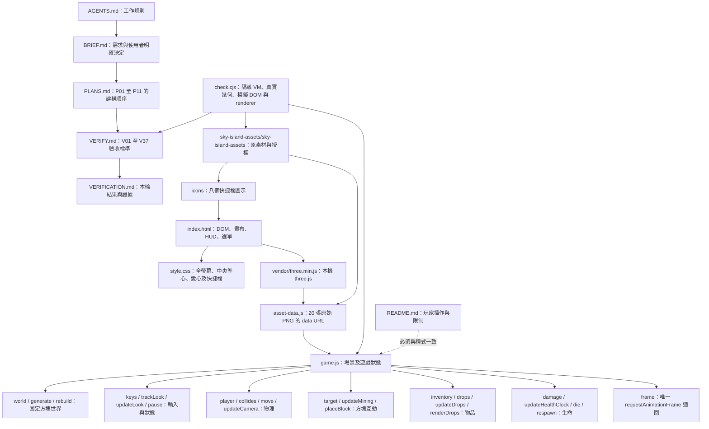
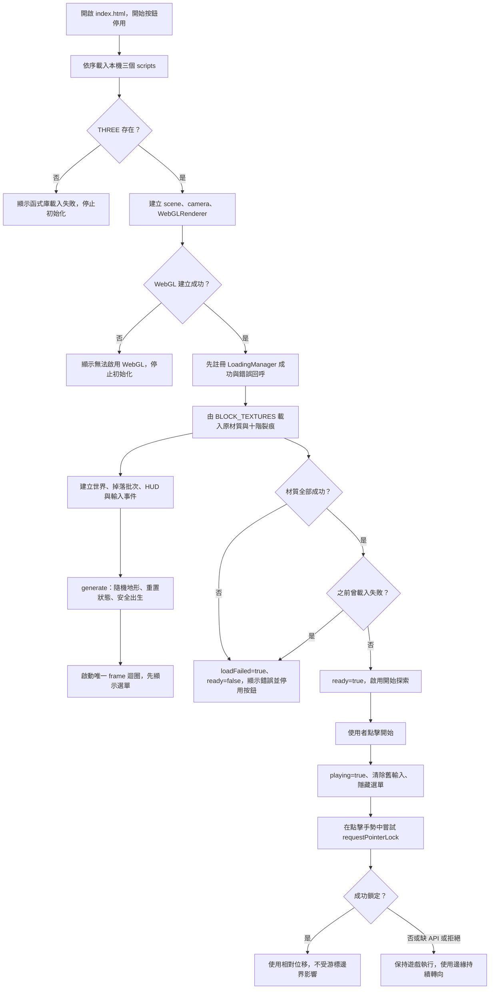
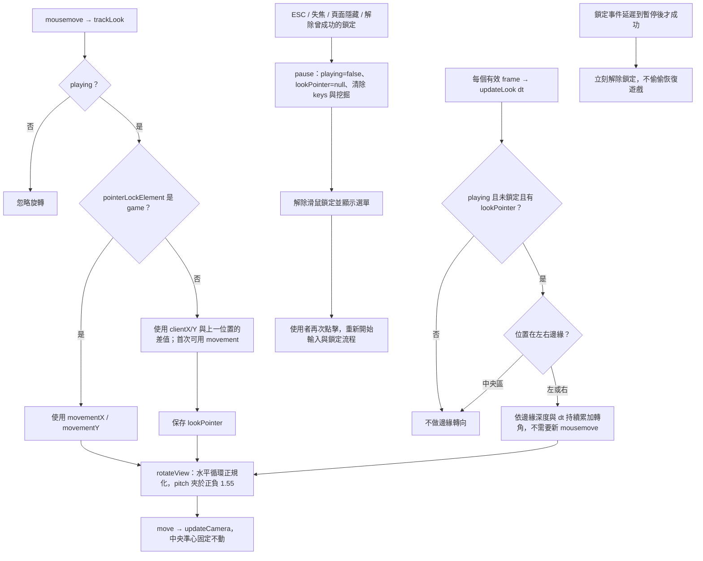
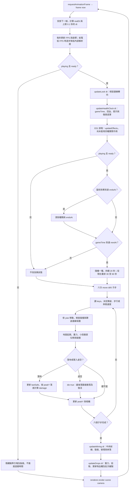
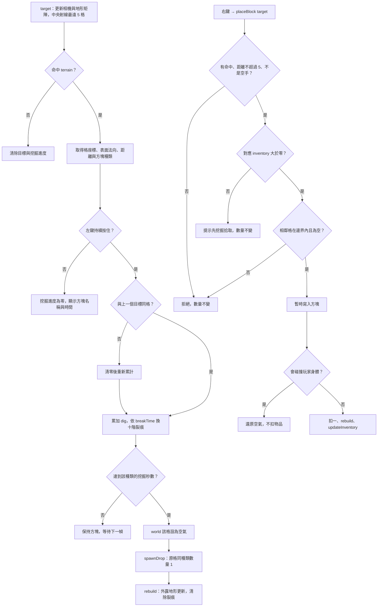
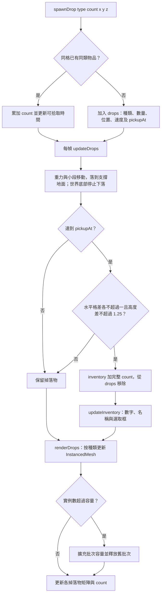
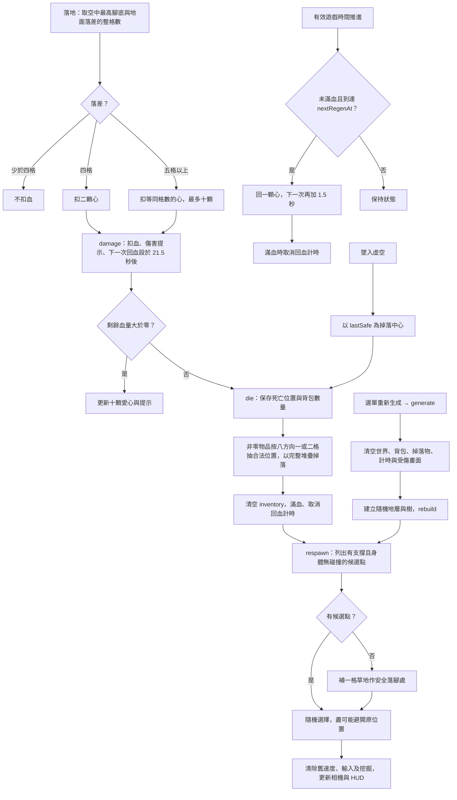
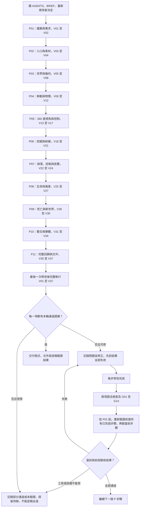

# MERMAID.md：浮島工坊程式、功能與流程

圖中名稱對應目前 game.js。實作順序見 PLANS.md，驗收標準見 VERIFY.md，實際結果見 VERIFICATION.md。這些圖描述現有設計，不表示功能已經實機通過。沒有後端、多人、帳號或存檔服務。

## 1. 檔案與模組架構

載入依賴是先 DOM，再 three.js、asset-data.js、game.js；素材包保留原始位置，不能因重構改壞既有相對路徑。

## 2. 啟動與載入狀態

材質載入回呼非同步發生；上圖中建立世界不等同載入成功。只有 ready 才能開始。測試：V03、V04、V13、V14、V17；G12、G13、G14。

## 3. 360 度視角與暫停

yaw 正規化只是避免無限累積數值，不限制可以旋轉的圈數。相容模式移到邊緣會持續轉，移回中央停止邊緣轉向；pitch 只限制上下以避免翻轉。測試：V09、V13～V17；G03、G06、G11～G13。

## 4. 每幀更新、物理與繪製

resize 同步相機比例、內部解析度與畫布顯示尺寸。FPS 以 realDt 統計，遊戲物理使用受限 dt；模擬不能代表目標硬體的 FPS。測試：V08～V12、V17、V25～V27、V31、V32。

## 5. 挖掘、放置與數量守恆

射線只選地形，避免選中裂痕或掉落物。取消挖掘、換目標與暫停都不保留舊進度。測試：V18～V24；G02、G04、G06。

## 6. 掉落物與拾取

空氣不掉落；物品堆疊不是只保留一個物品。死亡的 inventory 也經過相同 spawnDrop 流程。測試：V21～V24、V28；G04、G05、G06、G10。

## 7. 生命、回血、死亡與新世界

新傷會重設回血等待；gameTime 在暫停時不前進。死亡後可重新拾回散落物；關閉或重新整理頁面不保存狀態。測試：V25～V30、V33；G01、G07～G10。

## 8. 建構順序與強制完整回歸

P01～P11 是依賴順序；旁邊的「每步修改完成」子流程適用於每一個 P 步驟。後段修正不得只測局部，必須使先前結果失效並從 P01 重驗所有已完成內容。手動或目標硬體證據不能由邏輯測試代替。

### 隨機效果 E01 變更紀錄

本輪先完成排程狀態：effectState 包含 type、endsAt、nextAt，generate 呼叫 resetEffects；frame 在 updateHealthClock 後、move 前呼叫 updateEffects。上方第 4 圖納入到期與觸發分支。進入新世界重抽首次 30～60 秒，依遊戲時間計算且暫停不前進；不變更實際移動、跳躍及霧效果。

未完成：E02 加速/減速倍率、E03 跳躍多三格、E04 三格內漸層與三格外全黑。這些都必須各自先紅燈提交、實作、全套前段重驗，再綠燈提交，完成一步就停止。架構文件同步不代表獲得修改 VERIFY.md 的授權。
